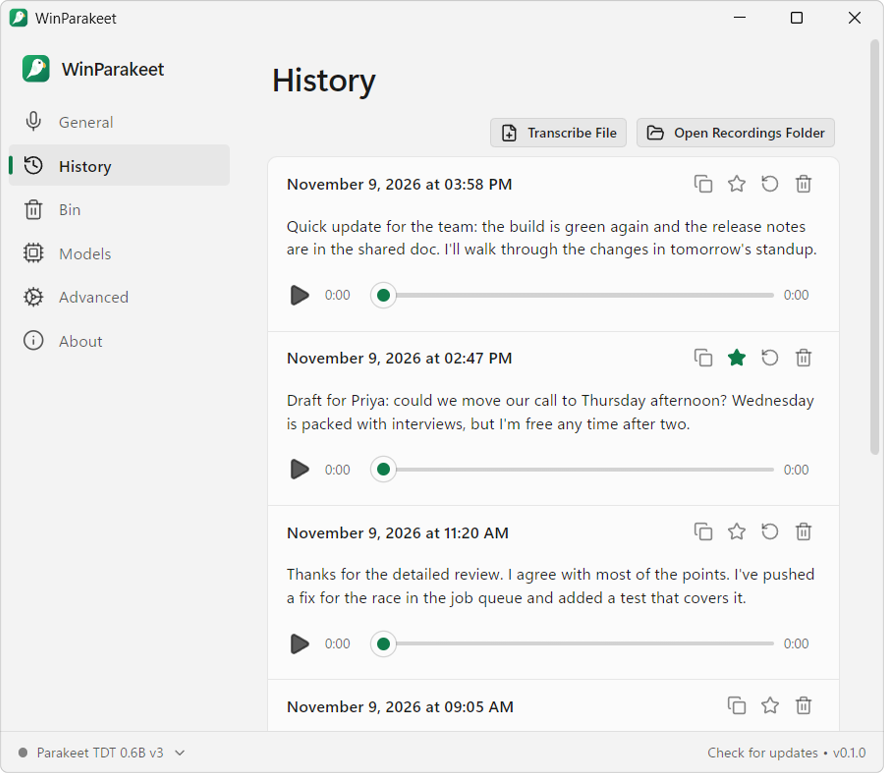
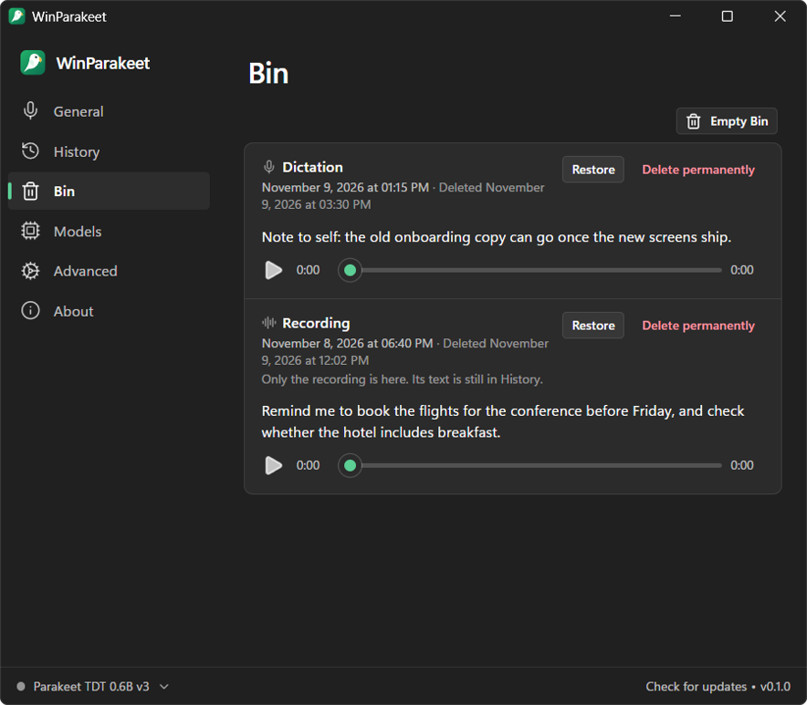
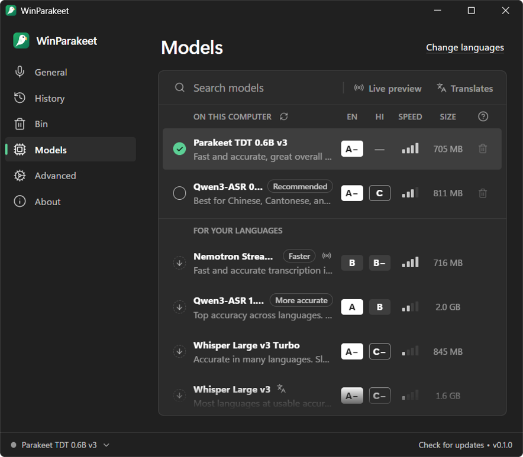
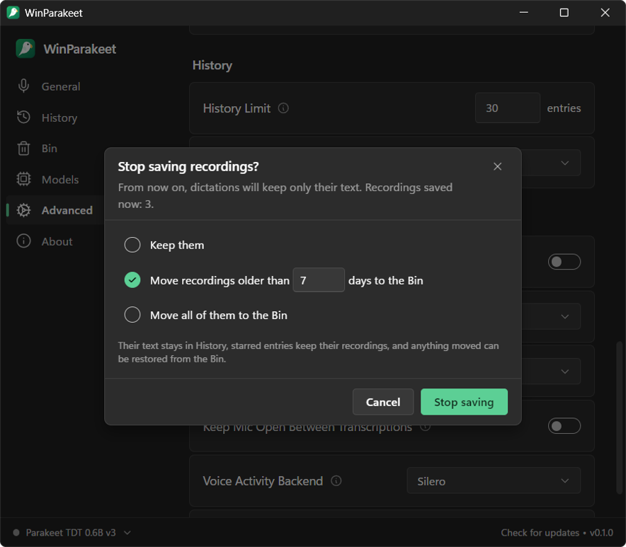
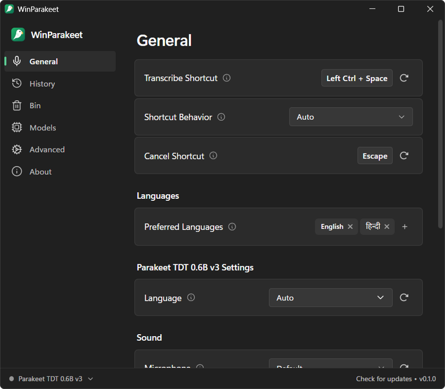

# WinParakeet

Private, offline speech-to-text for Windows. Dictate into any app with a global shortcut, transcribe audio and video files, and (next) record and transcribe meetings. Speech recognition runs on your own machine; no audio leaves it.

<p align="center">
  <picture>
    <source media="(prefers-color-scheme: dark)" srcset="docs/screenshots/history-dark.png">
    
  </picture>
</p>

WinParakeet is built on [Handy](https://github.com/cjpais/Handy) by CJ Pais and contributors. See [Built on Handy](#built-on-handy).

## Status

Today WinParakeet does what Handy 0.10 does, with a Windows-first focus:

- Hold or tap a shortcut, speak, and the text is pasted where your cursor is.
- Local models through [transcribe.cpp](https://github.com/handy-computer/transcribe.cpp) (ggml/GGUF): NVIDIA Parakeet TDT v3 and v2, Whisper, Moonshine, SenseVoice and more, with Vulkan GPU acceleration.
- Transcribe audio and video files by dropping them on the window; history with playback.
- Nothing is deleted behind your back: deleted entries, entries cleaned up from History and recordings you let go all land in the **Bin**, where you can restore them or delete them for good.
- Keep only the text if you like: **Advanced → Clean Up History → Don't save recordings** stops writing dictation audio to disk, and asks what to do with the recordings you already have (keep them, or move all or the older ones to the Bin).
- Optional LLM clean-up of transcripts through OpenAI-compatible endpoints (Ollama, LM Studio, or a cloud provider).

While you hold the shortcut, a small pill at the bottom of the screen shows that it's listening:

<p align="center"></p>

Next: meeting recording.

- [ ] Record the microphone and system audio (WASAPI loopback) as separate, crash-safe tracks
- [ ] Live preview while recording; a final transcript of each track after the call, labelled "Me" and "Them"
- [ ] Speaker diarization of the system track
- [ ] Meeting library, summaries and chat through your own LLM endpoint

## Screenshots

|                                                                                                              |                                                                                                                     |
| ------------------------------------------------------------------------------------------------------------ | ------------------------------------------------------------------------------------------------------------------- |
|  |  |
| **Bin:** deleted dictations and recordings wait here until you restore them or delete them for good.         | **Models:** graded for the languages you speak, with sizes, speed, and which ones show live text.                   |
|   |                                 |
| **Stop saving recordings:** keep the ones you have, or move all or the older ones to the Bin.                | **General:** the shortcut, how it behaves, and your languages.                                                      |

## Install

There are no releases yet. Every push to `main` builds Windows installers: open the latest run of the [Windows build](https://github.com/azain47/winparakeet/actions/workflows/windows.yml) workflow and download the `winparakeet-windows-x64` artifact (NSIS `.exe` and `.msi`). The builds are not code-signed, so SmartScreen warns before the first launch.

## Build from source

See [BUILD.md](BUILD.md). The quickest path cross-compiles from WSL:

```bash
wsl -d Ubuntu -e bash /mnt/d/winparakeet/scripts/build-windows-wsl.sh --run
```

## Built on Handy

WinParakeet started as a copy of Handy 0.10.0. The dictation app, model catalog, transcription engine integration and most of the UI are Handy's work, used under the MIT license; the git history keeps every Handy commit. Handy's name, logo, icon and brand assets are not covered by that license, so WinParakeet uses its own name and artwork and is not affiliated with or endorsed by Handy.

Models download from Handy's [Hugging Face organization](https://huggingface.co/handy-computer), as they do in Handy.

If WinParakeet is useful to you, consider supporting Handy: [handy.computer/donate](https://handy.computer/donate).

## Command line

Flags for controlling a running instance (sent through the single-instance plugin):

```powershell
winparakeet.exe --toggle-transcription    # Toggle recording on/off
winparakeet.exe --toggle-post-process     # Toggle recording with post-processing on/off
winparakeet.exe --cancel                  # Cancel the current operation
```

Startup flags:

```powershell
winparakeet.exe --start-hidden            # Start without showing the main window
winparakeet.exe --no-tray                 # Start without the system tray icon
winparakeet.exe --debug                   # Enable debug mode with verbose logging
winparakeet.exe --help                    # Show all available flags
```

Press `Ctrl+Shift+D` in the settings window to show the Debug section.

## Troubleshooting

### The shortcut does nothing in an administrator window

Windows doesn't let a normal app see keys typed into a window running as administrator, or paste into it (User Interface Privilege Isolation). With WinParakeet running normally, dictation therefore does nothing in an elevated terminal (for example Windows Terminal with `"elevate": true`) or any other admin app.

Either run that app without administrator rights, or run WinParakeet as administrator: right-click `winparakeet.exe` → **Properties → Compatibility → Run this program as an administrator**. Windows then asks for permission (UAC) at every launch, and dragging files from Explorer onto WinParakeet stops working; use **History → Transcribe File** instead.

### Your previous clipboard content is pasted instead of the transcription

With the default clipboard paste method, the previous clipboard is restored after a fixed delay. A busy application may read the clipboard only after that. Open the Debug section (`Ctrl+Shift+D`) and try **Reliable Paste (Beta)**, or raise **Paste Delay (After)**.

### Vulkan overlays and capture tools

WinParakeet asks the Vulkan loader to skip implicit layers, because overlay and capture hooks crash the GPU backend. GPU acceleration stays on. To keep those layers for GPU selection or debugging, quit WinParakeet (including the tray icon) and start it from PowerShell:

```powershell
$env:HANDY_KEEP_VULKAN_IMPLICIT_LAYERS = "1"
& "$env:LOCALAPPDATA\WinParakeet\winparakeet.exe"
```

That is the installer's default folder; adjust the path if you installed elsewhere. The variable keeps Handy's name so upstream changes merge cleanly. An existing `VK_LOADER_LAYERS_DISABLE` value is also respected.

### Where settings and logs live

Settings and history live in `%APPDATA%\com.azain47.winparakeet`, logs in `%LOCALAPPDATA%\com.azain47.winparakeet\logs`. A portable install keeps its data in a `Data` folder beside the executable. Settings → About shows both folders.

## License

MIT, see [LICENSE](LICENSE). The license covers Handy's code (copyright CJ Pais) and WinParakeet's changes.

## Acknowledgments

- [Handy](https://github.com/cjpais/Handy) by CJ Pais and contributors, the foundation of this app
- [transcribe.cpp](https://github.com/handy-computer/transcribe.cpp) and [ggml](https://github.com/ggml-org/ggml) for on-device inference
- NVIDIA for the Parakeet models, OpenAI for Whisper, and Silero for voice activity detection
- [Tauri](https://tauri.app) for the app framework
