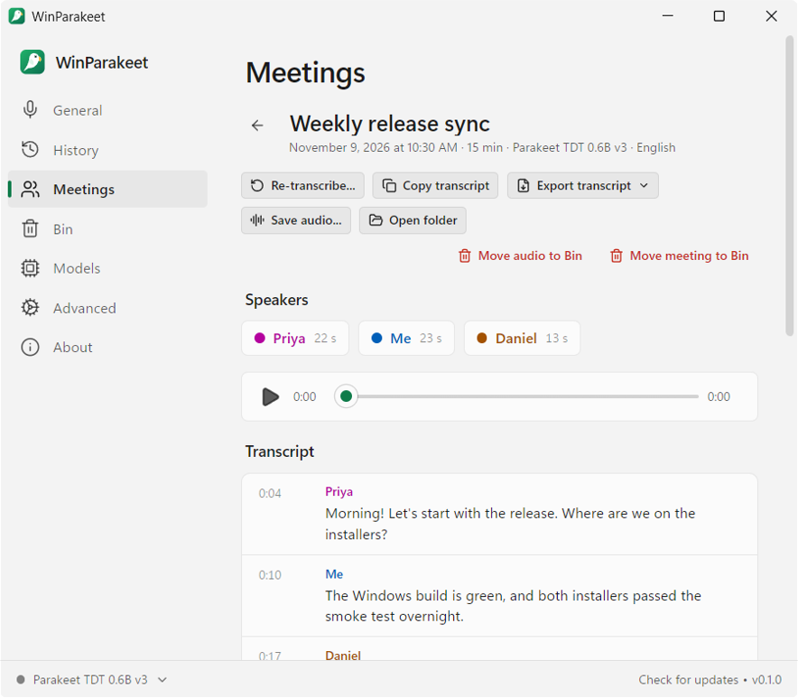
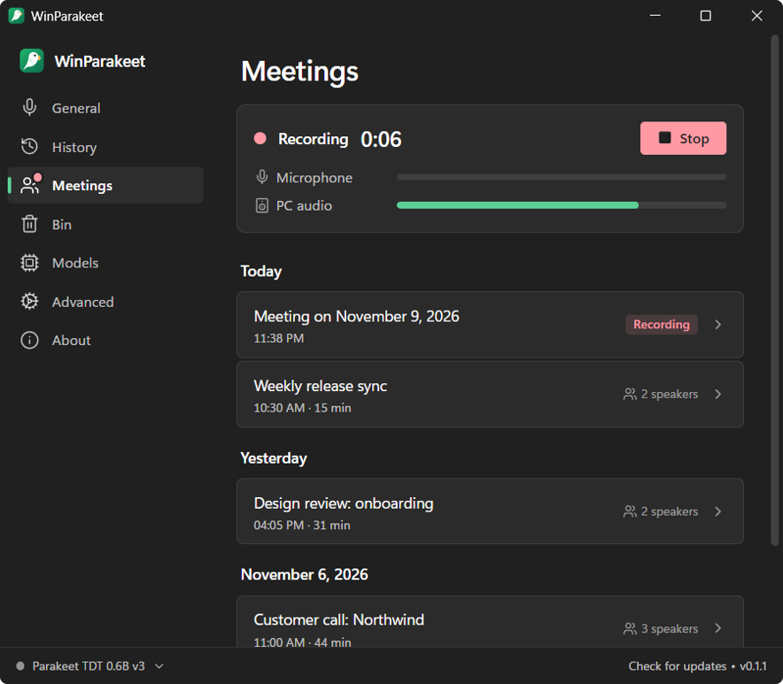
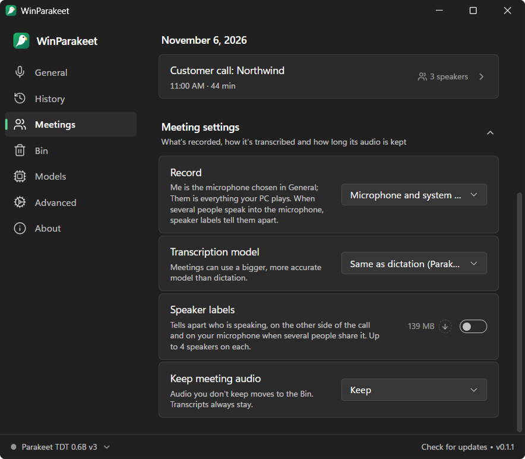

# WinParakeet

Private, offline speech-to-text for Windows. Dictate into any app with a global shortcut, record and transcribe meetings, and transcribe audio and video files. Speech recognition runs on your own machine; no audio leaves it.

<p align="center">
  <picture>
    <source media="(prefers-color-scheme: dark)" srcset="docs/screenshots/history-dark.png">
    
  </picture>
</p>

WinParakeet is built on [Handy](https://github.com/cjpais/Handy) by CJ Pais and contributors. See [Built on Handy](#built-on-handy).

## Dictation

- Hold or tap a shortcut, speak, and the text is pasted where your cursor is.
- Local models through [transcribe.cpp](https://github.com/handy-computer/transcribe.cpp) (ggml/GGUF): NVIDIA Parakeet TDT v3 and v2, Whisper, Moonshine, SenseVoice and more, with Vulkan GPU acceleration.
- The Live overlay (the default) shows your words while you talk, with any model: streaming models update as you speak, the others decode the recording again every 0.7 s or so. On a machine too slow for that, the text shows when you stop.
- Transcribe audio and video files by dropping them on the window; history with playback.
- Deleted entries, entries removed by History cleanup, and recordings you stop keeping go to the **Bin**, where you can restore them or delete them for good.
- **Advanced → Clean Up History → Don't save recordings** stops saving dictation audio, and asks what to do with the recordings you already have: keep them, or move all or the older ones to the Bin.
- Optional LLM clean-up of transcripts through OpenAI-compatible endpoints (Ollama, LM Studio, or a cloud provider).

While you dictate, a pill shows the microphone level and a cancel button:

<p align="center"></p>

## Meetings

The **Meetings** tab records a call without joining it: your microphone ("Me") and whatever the computer plays (the other side of a Teams, Zoom or Meet call) are recorded as two separate tracks. After the call both are transcribed on your machine, with timestamps.

<p align="center">
  <picture>
    <source media="(prefers-color-scheme: dark)" srcset="docs/screenshots/meeting-dark.png">
    
  </picture>
</p>

While a meeting records, a red bar shows the elapsed time, the microphone and PC audio levels, and a Stop button:

<p align="center"></p>

- Start and stop from the Meetings tab, the tray menu, or `winparakeet.exe --toggle-meeting`. You can dictate during a meeting.
- Speaker labels (optional, a 139 MB download of NVIDIA's Sortformer) tell apart up to four speakers on each side. Click a speaker to name them.
- The audio is written to disk while it records; if WinParakeet crashes or is killed mid-call, the recording is recovered on its next launch.
- Meetings have their own settings: what to record (both sides, only the microphone, or only system audio), which model transcribes them, and how long to keep the audio. It's kept by default, so you can **re-transcribe** a meeting later with another model; or it can move to the Bin after transcription or after 7, 30 or 90 days. Transcripts stay.
- Export the transcript as text, Markdown, SRT or WebVTT subtitles, or JSON; save the audio as one WAV with both sides mixed, or open the folder with each side's track.
- Deleting a meeting, or only its audio, moves it to the Bin.

Not yet: a live transcript during the call, summaries and chat through your own LLM endpoint.

## Screenshots

|                                                                                                                  |                                                                                                                        |
| ---------------------------------------------------------------------------------------------------------------- | ---------------------------------------------------------------------------------------------------------------------- |
|      |     |
| **Bin:** deleted dictations and recordings, until you restore them or delete them for good.                      | **Models:** graded for the languages you speak, with size, speed, and which ones stream.                               |
|       |                                    |
| **Stop saving recordings:** keep the ones you have, or move all or the older ones to the Bin.                    | **General:** the shortcut, how it behaves, and your languages.                                                         |
|     |                                |
| **Meetings:** a recording in progress, with the elapsed time and both sides' levels, above the list of meetings. | **Meeting settings:** what to record, which model transcribes meetings, speaker labels, and whether to keep the audio. |

## Install

Download the installer from the [latest release](https://github.com/azain47/winparakeet/releases/latest): `WinParakeet_<version>_x64-setup.exe`, or the `.msi` for managed installs. WinParakeet checks for new releases and offers to install them.

The installers aren't code-signed yet, so Windows SmartScreen warns before the first launch: choose **More info → Run anyway**.

Every push to `main` also builds installers: the latest run of the [Windows build](https://github.com/azain47/winparakeet/actions/workflows/windows.yml) workflow has them as the `winparakeet-windows-x64` artifact.

## Build from source

See [BUILD.md](BUILD.md). The quickest path cross-compiles from WSL:

```bash
wsl -d Ubuntu -e bash /mnt/d/winparakeet/scripts/build-windows-wsl.sh --run
```

## Built on Handy

WinParakeet started as a copy of Handy 0.10.0. The dictation app, model catalog, transcription engine integration and most of the UI are Handy's work, used under the MIT license; the git history keeps every Handy commit. Handy's name, logo, icon and brand assets are not covered by that license, so WinParakeet uses its own name and artwork and is not affiliated with or endorsed by Handy.

Models download from Handy's [Hugging Face organization](https://huggingface.co/handy-computer), as they do in Handy.

If WinParakeet is useful to you, consider supporting Handy: [handy.computer/donate](https://handy.computer/donate).

## Command line

Flags for controlling a running instance (sent through the single-instance plugin):

```powershell
winparakeet.exe --toggle-transcription    # Toggle recording on/off
winparakeet.exe --toggle-post-process     # Toggle recording with post-processing on/off
winparakeet.exe --toggle-meeting          # Start or stop recording a meeting
winparakeet.exe --cancel                  # Cancel the current operation
```

Startup flags:

```powershell
winparakeet.exe --start-hidden            # Start without showing the main window
winparakeet.exe --no-tray                 # Start without the system tray icon
winparakeet.exe --debug                   # Enable debug mode with verbose logging
winparakeet.exe --help                    # Show all available flags
```

Press `Ctrl+Shift+D` in the settings window to show the Debug section.

## Troubleshooting

### The shortcut does nothing in an administrator window

Windows doesn't let a normal app see keys typed into a window running as administrator, or paste into it (User Interface Privilege Isolation). With WinParakeet running normally, dictation therefore does nothing in an elevated terminal (for example Windows Terminal with `"elevate": true`) or any other admin app.

Either run that app without administrator rights, or run WinParakeet as administrator: right-click `winparakeet.exe` → **Properties → Compatibility → Run this program as an administrator**. Windows then asks for permission (UAC) at every launch, and dragging files from Explorer onto WinParakeet stops working; use **History → Transcribe File** instead.

### Your previous clipboard content is pasted instead of the transcription

With the default clipboard paste method, the previous clipboard is restored after a fixed delay. A busy application may read the clipboard only after that. Open the Debug section (`Ctrl+Shift+D`) and try **Reliable Paste (Beta)**, or raise **Paste Delay (After)**.

### Vulkan overlays and capture tools

WinParakeet asks the Vulkan loader to skip implicit layers, because overlay and capture hooks crash the GPU backend. GPU acceleration stays on. To keep those layers for GPU selection or debugging, quit WinParakeet (including the tray icon) and start it from PowerShell:

```powershell
$env:HANDY_KEEP_VULKAN_IMPLICIT_LAYERS = "1"
& "$env:LOCALAPPDATA\WinParakeet\winparakeet.exe"
```

That is the installer's default folder; adjust the path if you installed elsewhere. The variable keeps Handy's name so upstream changes merge cleanly. An existing `VK_LOADER_LAYERS_DISABLE` value is also respected.

### Where settings and logs live

Settings and history live in `%APPDATA%\com.azain47.winparakeet`, logs in `%LOCALAPPDATA%\com.azain47.winparakeet\logs`. A portable install keeps its data in a `Data` folder beside the executable. Settings → About shows both folders.

## License

MIT, see [LICENSE](LICENSE). The license covers Handy's code (copyright CJ Pais) and WinParakeet's changes.

## Acknowledgments

- [Handy](https://github.com/cjpais/Handy) by CJ Pais and contributors, the foundation of this app
- [transcribe.cpp](https://github.com/handy-computer/transcribe.cpp) and [ggml](https://github.com/ggml-org/ggml) for on-device inference
- NVIDIA for the Parakeet models and Sortformer speaker diarization, OpenAI for Whisper, and Silero for voice activity detection
- [MacParakeet](https://github.com/moona3k/macparakeet), whose meeting design WinParakeet's meetings follow
- [Tauri](https://tauri.app) for the app framework
